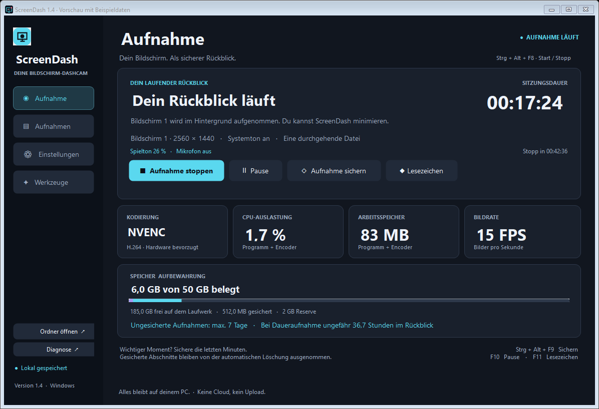
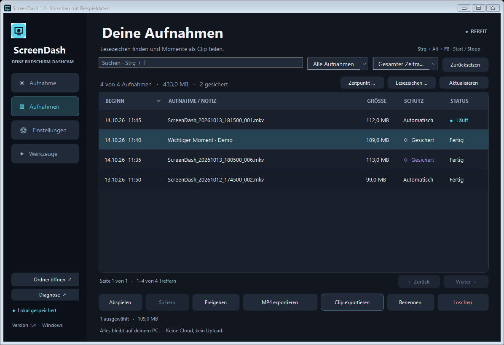
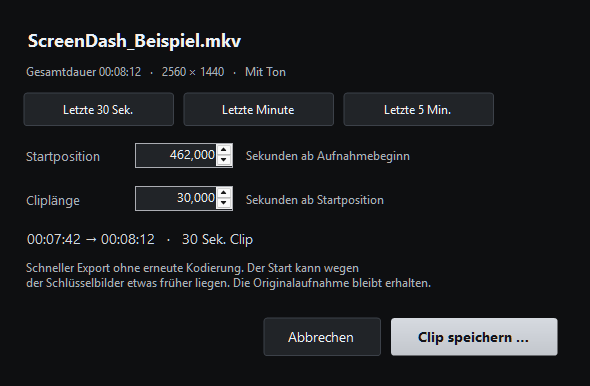
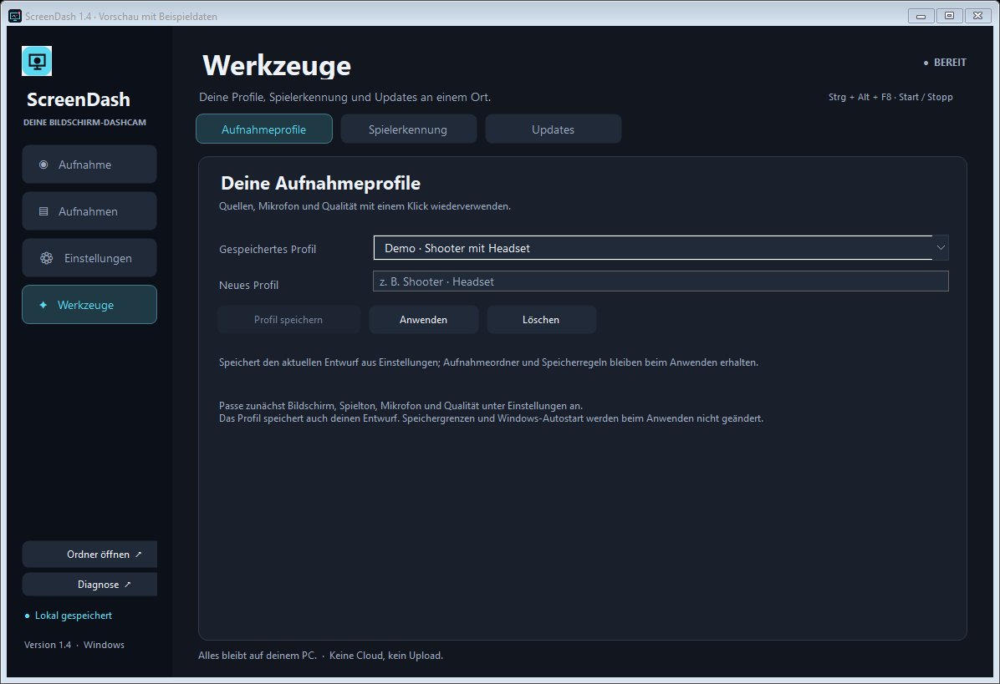

# ScreenDash

Eine lokale Bildschirm-Dashcam für **Windows 10/11 (64 Bit)**. ScreenDash zeichnet einen ausgewählten Monitor mit Systemton auf, speichert eine durchgehende Datei je Aufnahme und räumt alte Aufnahmen automatisch auf.

**[Windows-Version herunterladen](https://github.com/sercan1115/ScreenDash/releases/latest)** · [Anleitung](README.de.md) · [Neuerungen in 1.4](NEU-IN-1.4.de.md)



Die Bilder zeigen die Oberfläche mit Beispieldaten. Ihre Auslastungsanzeigen sind keine Messwerte.

## Funktionen

- **Lesezeichen:** während der Aufnahme Momente markieren, die ganze Datei schützen und später Clips davor/danach exportieren.
- **Spielerkennung:** bei ausgewählten Spielen automatisch starten/stoppen; manuelles Stoppen wird respektiert. Anfangs ausgeschaltet.
- **Aufnahmeprofile:** eigene Bildschirm-/Audio-/Qualitätseinstellungen speichern, ohne Speicherregeln oder Autostart zu verändern.
- **Tonwarnungen und Mikrofon:** fehlenden Spielton anzeigen; optional Stimme und Systemton mit getrennten Lautstärken in einer gemeinsamen Tonspur aufnehmen.
- **Manuelle Updates:** GitHub prüfen, Download abbrechen, SHA256 prüfen und zur neuen portablen EXE wechseln. Einstellungen und Aufnahmen bleiben erhalten.
- **Zeitpunkt suchen:** Aufnahme zu einem Datum und einer Uhrzeit finden und als Clip vorbereiten.

- **Clip-Export:** beliebigen Ausschnitt oder die letzten 30 Sekunden, eine Minute oder fünf Minuten als MP4 kopieren. Schneller Schnitt ohne Neukodierung, an Schlüsselbildern orientiert.
- **Aufnahme-Timer:** optional nach einer gewünschten aktiven Aufnahmedauer stoppen; Pausen halten den Countdown an.
- **Große Archive:** 200 Zeilen pro Seite, Filter über alle Aufnahmen, ohne Dateizugriffe beim Seitenwechsel.

- **Eine Datei:** kein Wechsel nach einer Minute; optionale Segmentierung bleibt verfügbar. Pause oder Stoppen schließt die laufende Datei.
- **Flüssiges Archiv:** Hintergrundladen, stabile Zeilen und Auswahl, echte Größen-/Zeitsortierung und neue Tastenkürzel.
- **Tonwerkzeuge:** aktive Ausgabe automatisch wählen, Tonpegel anzeigen, fünf Sekunden testen und den Windows-Mixer öffnen.

- **Automatische Aufbewahrung:** standardmäßig sieben Tage, mit einstellbarem Speicherlimit und freier Mindestreserve. Bei knappem Speicher werden ältere ungeschützte Aufnahmen schon früher gelöscht.
- **Wichtige Momente sichern:** Aufnahmen aus den letzten zehn Minuten einschließlich der gesamten laufenden Datei vor automatischem Löschen schützen.
- **Archiv:** suchen, nach Zeitraum und Schutz filtern, Bezeichnungen vergeben und mehrere Aufnahmen gemeinsam verwalten.
- **Pause und Fortsetzen:** der Encoder stoppt während der Pause; Fortsetzen beginnt einen neuen Abschnitt. PC-Sperre und Standby werden berücksichtigt.
- **MP4-Export:** abgeschlossene MKV-Aufnahmen ohne Neukodierung exportieren. Das Original bleibt erhalten; Export ist abbrechbar und Aufnahmebuttons bleiben verfügbar.
- **Tray und Tastenkürzel:** im Hintergrund bedienen; Windows-Autostart und Aufnahme beim Programmstart sind optional.
- **Lokale Speicherung:** Videos, Einstellungen und Protokolle bleiben auf dem PC. Die App lädt keine Aufnahmen hoch.







## Starten

1. Die Windows-ZIP aus den [Releases](https://github.com/sercan1115/ScreenDash/releases/latest) herunterladen und vollständig entpacken.
2. FFmpeg separat installieren, zum Beispiel in PowerShell:

   ```powershell
   winget install --id Gyan.FFmpeg -e
   ```

3. `ScreenDash.exe` öffnen, Bildschirm, Tonausgabe und Aufnahmeordner wählen, Einstellungen speichern und die Aufnahme starten.

Die portable App enthält die .NET-Laufzeit. FFmpeg ist separat erforderlich; ScreenDash findet `ffmpeg.exe` neben der App, unter `tools/ffmpeg.exe` oder im Windows-PATH. Die Clipprüfung benötigt außerdem `ffprobe.exe` aus derselben vollständigen Installation. Die FFmpeg-Ausgabe muss `ddagrab` und einen passenden Hardware-Encoder unterstützen.

| Tastenkürzel | Aktion |
| --- | --- |
| Strg + Alt + F8 | Aufnahme starten / stoppen |
| Strg + Alt + F9 | Letzte Minuten schützen |
| Strg + Alt + F10 | Aufnahme pausieren / fortsetzen |
| Strg + Alt + F11 | Lesezeichen setzen und ganze Datei schützen |

## Auf geringe Belastung ausgelegt

ScreenDash nutzt DirectX Desktop Duplication und prüft beim Start einen Hardware-Encoder: NVIDIA NVENC, AMD AMF oder Intel Quick Sync. Das Standardprofil verwendet **15 FPS und etwa 3 Mbit/s**. Ein Ultrasparprofil mit 10 FPS und individuelle Einstellungen sind ebenfalls verfügbar. CPU-Encoding muss ausdrücklich erlaubt werden.

Eine laufende Videovorschau entfällt; Audio verwendet einen begrenzten Puffer und FFmpeg läuft mit niedriger Prozesspriorität. Aufnahme und Dateischreiben benötigen dennoch CPU, GPU und Speicherbandbreite. Der kurze AMD-Test und seine Grenzen stehen im [Testbericht](TESTBERICHT.de.md); eine bestimmte Spieleleistung wird nicht zugesichert.

Das Standardlimit von **50 GiB** reicht bei Daueraufnahme im Standardprofil ungefähr 35–38 Stunden. Für sieben volle Tage werden grob 240 GB benötigt. Geschützte Videos zählen zum Limit; reicht der Platz trotz Bereinigung nicht aus, stoppt die Aufnahme.

## Quellcode bauen

Voraussetzungen: Windows und das **.NET-8-SDK**. FFmpeg wird für echte Aufnahmen benötigt.

```powershell
git clone https://github.com/sercan1115/ScreenDash.git
cd ScreenDash
.\build.ps1
```

Das Skript führt 177 Prüfungen für Speicher, Lesezeichen, Zustände, Medien, Audio, Spielerkennung, Profile und Updates ohne Aufnahme aus und baut die portable App nach `dist`. GitHub Actions führt dieselben Tests auf Windows aus und erzeugt ein Build-Artefakt. Die Windows-Version steht in den Releases.

Zusätzliche Integrationstests benötigen einen interaktiven Windows-Desktop, einen Monitor, FFmpeg und gegebenenfalls ein Audiogerät. Sie zeichnen echte Bildschirminhalte auf und sind daher kein Bestandteil des CI-Laufs. Hinweise und Ergebnisse: [Testbericht](TESTBERICHT.de.md).

## Grenzen und Lizenzen

Aufgenommen wird ein Monitor in seiner nativen Auflösung, der Ton eines Wiedergabegeräts und auf Wunsch ein Mikrofon. Gerätewechsel, Remote-Sitzungen und geschützte Inhalte können die Aufnahme unterbrechen. Die letzten Sekunden eines bei einem Absturz offenen Abschnitts können verloren gehen. Weitere Details stehen in der [Anleitung](README.de.md).

Der ScreenDash-Quellcode steht unter der [MIT-Lizenz](LICENSE). Für NAudio und die mitgelieferte .NET-Laufzeit gelten die [Drittanbieter-Lizenzen](Drittanbieter-Lizenzen.txt). FFmpeg wird nicht mitgeliefert und steht unter den Lizenzbedingungen der jeweils installierten Ausgabe.
